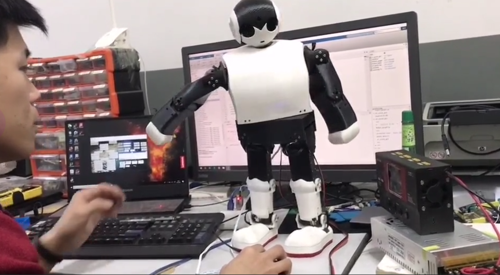
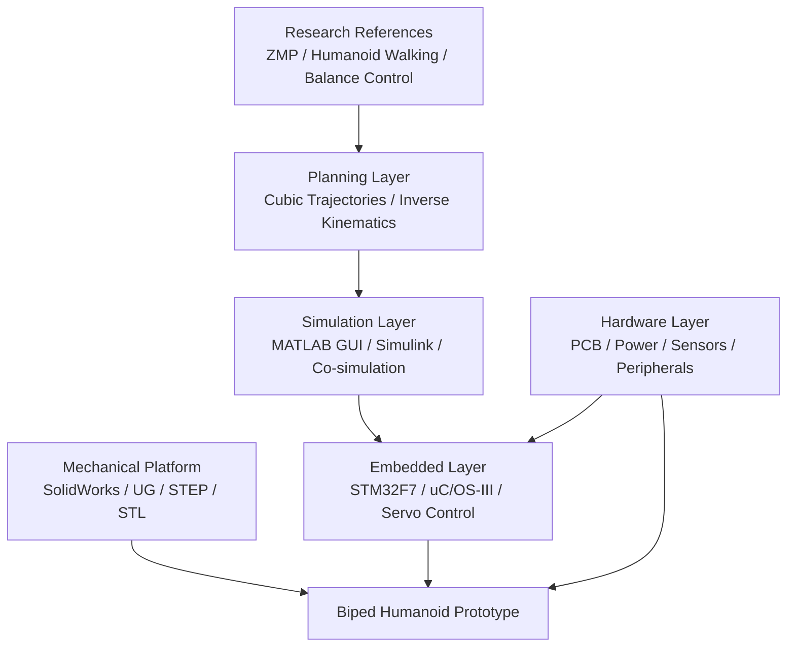

MECHATRONICS RESEARCH ARCHIVE / HUMANOID ROBOTICS / EMBEDDED CONTROL

# Biped Humanoid Robot Project

  <strong>A complete biped robot R&D archive, from gait theory and mechanical design to STM32 firmware, PCB modules, MATLAB GUI tooling, and Simulink co-simulation.</strong>

  <code>Static ZMP Walking</code>
  <code>Cubic Trajectory Planning</code>
  <code>Inverse Kinematics</code>
  <code>STM32F7</code>
  <code>uC/OS-III</code>
  <code>MATLAB / Simulink</code>

  <a href="#design-intent">Design Intent</a> ·
  <a href="#system-composition">System Composition</a> ·
  <a href="#research-stack">Research Stack</a> ·
  <a href="#repository-atlas">Repository Atlas</a> ·
  <a href="#demo-videos">Demo Videos</a> ·
  <a href="#getting-started">Getting Started</a>

---

## Design Intent

This project is a biped humanoid robot prototype built as an integrated robotics system rather than an isolated software demo. The repository captures the full development surface: mechanical structure, walking theory, trajectory generation, embedded control, board-level electronics, simulation, GUI tooling, and experimental peripherals.

The robot is designed around **static Zero Moment Point (ZMP) walking**. A MATLAB and Simulink workflow is used to prepare motion data and validate behavior, while the lower-level controller is based on an STM32F7/STM32F767 embedded platform with uC/OS-III. Motion generation combines cubic polynomial trajectories with inverse kinematics before commands are sent toward the physical robot.

## System Composition

| Discipline | Design Focus | What This Repository Preserves |
| --- | --- | --- |
| Mechanical design | Human-like body structure, foot geometry, limb assemblies, servo mounting, printable/exportable models. | SolidWorks, UG/NX, STEP, STL, OBJ, and assembly resources. |
| Motion planning | Static ZMP walking, trajectory smoothness, joint-space command generation, walking data preparation. | MATLAB gait scripts, trajectory-planning notes, Simulink models, walking utilities. |
| Embedded control | Real-time task organization, servo control, serial communication, sensor access, STM32 peripheral setup. | STM32F7/STM32F767 firmware, Keil projects, uC/OS-III assets, CubeMX I/O configuration. |
| Electronics | Base board, power distribution, voltage acquisition, force sensing, display and peripheral interfaces. | Altium schematics, PCB layouts, libraries, design outputs, device datasheets. |
| Experimental modules | HMI display, localization, human sensing, voice recognition, image-transfer experiments. | Module documents, sample projects, archived code, device manuals, reference material. |

## Research Stack

| Layer | Primary Assets | Notes |
| --- | --- | --- |
| Mechanical platform | `robot_solidworks/`, `UG图纸/`, `Robot with simulink and GUI/*.STEP` | Body, limbs, feet, servo structures, assembly exports, and fabrication-oriented files. |
| Planning and simulation | `robot_matlab/`, `Robot with simulink and GUI/ROBOT.slx`, `ROBOT.rxw64`, `slprj/` | MATLAB scripts, GUI files, Simulink models, and real-time synchronization artifacts. |
| Embedded controller | `机器人步态规划下位机代码/`, `ROBOT_IO.ioc` | STM32F7/STM32F767 firmware, uC/OS-III resources, Keil project files, and I/O configuration. |
| Electronics and sensing | `机器人底板设计/`, `机器人压力检测/`, `机器人电能供应、采集/` | Base board, pressure sensing, power management, voltage acquisition, and PCB design files. |
| Peripherals | `机器人信息显示/`, `机器人定位系统/`, `机器人人体感应/`, `机器人语音识别/`, `机器人图像传输/` | Display, GPS/localization, human sensing, voice recognition, and camera/image-transfer resources. |

## Repository Atlas

### Core Robot Development

| Path | Role |
| --- | --- |
| `robot_matlab/` | MATLAB scripts, gait functions, serial communication utilities, GUI files, and generated Simulink-related assets. |
| `Robot with simulink and GUI/` | Main Simulink models, MATLAB GUI files, walking-data tools, STEP exports, and real-time synchronization files. |
| `机器人步态规划下位机代码/` | Lower-level robot-control firmware, STM32F7/STM32F767 Keil projects, uC/OS-III assets, and gait-control references. |
| `robot_solidworks/` | SolidWorks part and assembly files for the humanoid body and mechanical subsystems. |
| `UG图纸/` | UG/NX design files, STL exports, OBJ assets, and mechanical drawings. |

### Electronics and Module Design

| Path | Role |
| --- | --- |
| `机器人底板设计/` | Robot base-board schematics, PCB layouts, Altium libraries, logs, and output files. |
| `机器人压力检测/` | FSR/pressure-sensing circuit design, documentation, Altium project files, and PCB outputs. |
| `机器人电能供应、采集/` | Power supply and voltage acquisition designs, LM2596/LM358 references, schematics, PCBs, and drawings. |
| `机器人信息显示/` | Serial HMI project files, fonts, protocol documents, sample resources, and display tooling. |
| `机器人定位系统/` | GPS/localization module resources, datasheets, usage documents, and archived project assets. |
| `机器人人体感应/` | Human-sensing sensor references, including AMN311 and AM412 documentation. |
| `机器人语音识别/` | Voice-recognition design notes and LD3320-related material. |
| `机器人图像传输/` | Camera and image-transfer module resources with STM32 camera-related code archives. |

### Research and Supporting Material

| Path | Role |
| --- | --- |
| `Humanoid robot paper/` | Technical papers on humanoid robots, ZMP, gait generation, walking control, and robotics fundamentals. |
| `Mechanical arm/` | Additional mechanical-arm research, MATLAB assets, programs, and design materials. |
| `WALK OF THE ROBOT/` | Additional walking-control and embedded-system resources. |
| `README.assets/` | Visual assets used by this README. |
| `ROBOT_IO.ioc` | STM32CubeMX robot I/O configuration file. |
| `ROBOT.rxw64` | Simulink Desktop Real-Time target artifact. |
| `轨迹规划.docx` | Trajectory-planning document. |

## Demo Videos

The original README used embedded Bilibili iframes, which do not render reliably on many code-hosting platforms. The demonstrations are preserved here as direct links.

| Demo | Video |
| --- | --- |
| 01 | [BV12N4y1G7w9](https://www.bilibili.com/video/BV12N4y1G7w9) |
| 02 | [BV1fa411o7Mp](https://www.bilibili.com/video/BV1fa411o7Mp) |
| 03 | [BV17v4y1c7NV](https://www.bilibili.com/video/BV17v4y1c7NV) |
| 04 | [BV1tG411t7Mn](https://www.bilibili.com/video/BV1tG411t7Mn) |
| 05 | [BV1UB4y167KH](https://www.bilibili.com/video/BV1UB4y167KH) |
| 06 | [BV1XY4y1F7fy](https://www.bilibili.com/video/BV1XY4y1F7fy) |
| 07 | [BV1pa411Z7g4](https://www.bilibili.com/video/BV1pa411Z7g4) |

## Getting Started

This repository spans mechanical design, firmware, simulation, electronics, and documentation. There is no single command that builds or runs the whole system; start from the layer you want to study.

| Goal | Recommended Entry Point | Tooling |
| --- | --- | --- |
| Understand the physical robot | `robot_solidworks/`, `UG图纸/`, `README.assets/` | SolidWorks, Siemens NX/UG, STL/OBJ viewers |
| Study gait and motion generation | `robot_matlab/`, `轨迹规划.docx` | MATLAB |
| Inspect simulation and co-simulation | `Robot with simulink and GUI/ROBOT.slx`, `ROBOT.rxw64`, `slprj/` | MATLAB, Simulink, Simulink Desktop Real-Time |
| Review embedded control | `机器人步态规划下位机代码/`, `ROBOT_IO.ioc` | Keil MDK, STM32CubeMX |
| Review electronics | `机器人底板设计/`, `机器人压力检测/`, `机器人电能供应、采集/` | Altium Designer |
| Explore peripheral experiments | `机器人信息显示/`, `机器人定位系统/`, `机器人语音识别/`, `机器人图像传输/` | Module-specific vendor tools and documentation |

## Technical Notes

| Topic | Notes |
| --- | --- |
| Static ZMP walking | The gait design targets stable walking by keeping the support conditions compatible with static ZMP assumptions. |
| Cubic trajectory planning | Cubic polynomial trajectories are used to produce smooth motion references for walking. |
| Inverse kinematics | Desired motion is translated into joint commands before being sent toward the lower-level control system. |
| Embedded organization | STM32F7/STM32F767 firmware combines uC/OS-III, HAL/vendor support code, communication, and actuator/sensor routines. |
| MATLAB/Simulink workflow | MATLAB GUI files, scripts, and Simulink models support simulation, data preparation, and hardware-oriented co-simulation. |
| Hardware integration | The repository preserves PCB, power, pressure sensing, HMI, localization, voice, human-sensing, and image-transfer design material. |

## Project Status

This is a prototype and research archive from the robot development process. It is useful for studying a complete student-built humanoid robot workflow: literature review, mechanical design, gait planning, embedded firmware, simulation, PCB design, and hardware integration.

Some folders include generated files, archived tool outputs, vendor examples, and historical design files. When extending the project, treat the repository as a reference base and validate toolchain versions, hardware wiring, and firmware assumptions before running on physical equipment.

## License

No explicit open-source license is currently provided for this repository. Unless a license file is added, all rights are reserved by default.
